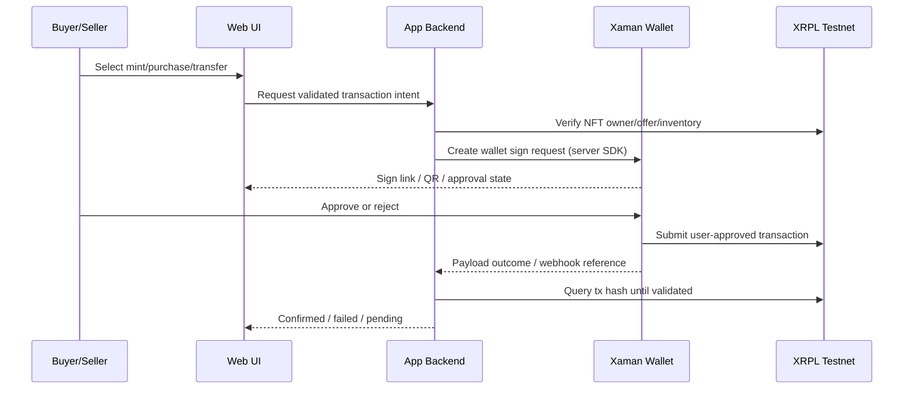

# XRPL Hackathon — Five Claude Agent Handoffs, Complete Issue Ownership & API Inventory

**Project:** NFT Ticketing, Merchandise & Fan Engagement Platform on XRP Ledger (XRPL)  
**Document type:** copy-ready coordination instructions; one Markdown file for all five Claude coding agents  
**Planning source:** `XRPL_GitHub_Kanban_Issues.md` (all 95 proposed issues) and `XRPL_Ticketing_Merchandise_Hackathon_Proposal.md`  
**Network:** XRPL **Testnet only** during the hackathon  
**Status:** Planning / handoff document. Does **not** create a GitHub Project, issues, commits or branches.  
**Date:** 20 November 2026

> **How to use this file:** Add it to the repository as `docs/CLAUDE_AGENT_HANDOFFS.md` (or paste the appropriate handoff section into each Claude agent's instructions). Give each agent the *same repository* plus the same shared rules, but tell it to follow only its allocated issue IDs. The IDs `XRPL-###` are planning IDs; match them to actual GitHub issue numbers after import. **No issue is assigned to more than one agent.**

## 1. Assignment summary and goals

This is an **end-to-end ticketing MVP first**, not five agents separately building five complete applications. Deliver a working flow: seller creates event and ticket tier → seller mints transferable NFT ticket → buyer purchases on Testnet → owner sees ticket → holder lists/gifts privately or resells in the app → organiser verifies current ownership and completes one-time entry. Physical merchandise, digital collectibles, community and Spotify are P1/P2 after that flow works.

| Agent | Specialism | Main code surfaces | P0 | P1 | P2 | Total |
|---|---|---|---:|---:|---:|---:|
| **A** — Platform, Auth & Data Integrity | Schema/migrations, auth, domain services, core backend, docs | 11 | 0 | 0 | **11** |
| **B** — XRPL, Wallet & NFT Transactions | `src/lib/xrpl/`, wallet signing, NFT + offer APIs | 19 | 0 | 1 | **20** |
| **C** — Customer/Seller UI & Discovery | `src/app/` views, `src/features/events/`, profiles | 11 | 9 | 4 | **24** |
| **D** — Check-in, Resale Policy & Analytics | `src/features/checkin/`, policy, organiser/metrics | 8 | 2 | 6 | **16** |
| **E** — Commerce, Community, QA & Demo | `src/features/commerce/`, community, CI/tests/demo | 5 | 13 | 6 | **24** |

**Single-owner rule:** An issue's assigned agent owns its implementation, tests, documentation, and issue status. Another agent may assist via an agreed handoff, but cannot independently take over that issue. For downstream dependencies, the owner should integrate the delivered contract rather than reimplementing it.

## 2. Mandatory instructions for ALL five Claude agents

### 2.1 Repository and Git permissions

1. **You MAY create branches, write code, run tests, create commits, and push branches** to the explicitly authorised repository/remote. Do not push to a repository or remote you have not been given permission to use.
2. Work on one branch per issue, never directly on protected `main`. Name branches `<type>/xrpl-###-what-it-does`, e.g. `docs/xrpl-001-architecture-and-demo-scope` or `feat/xrpl-024-mint-ticket-nft`, where `<type>` is the commit type (`feat`, `fix`, `chore`, `docs`, `test`, `refactor`). **Do not name branches after agents or people** (no `agent-a/...`). Use `XRPL-###` planning IDs in branch names until real GitHub issue numbers are available. When an issue depends on another unmerged issue, branch from that issue's branch.
3. Use clear human-readable commit messages such as `feat(nft): mint tickets on XRPL Testnet (XRPL-024)`; keep commits focused and make no unrelated formatting edits. **No `--force` pushes** to shared branches, no history rewriting to change attribution, and never bypass branch protections.
4. **Do not insert self-promotional or AI-attribution notes** into code, documentation, commit descriptions, issue descriptions, PR text, or source-code comments (for example, no “written by Claude”, “AI contributor”, or “Claude was the committer”). **Do not automatically append `Co-Authored-By: Claude` trailers.** This is a formatting instruction, *not* permission to forge or hide the true Git author/committer metadata: use the authentic account/identity authorised for this project and follow any organisation-required disclosure or attribution rules. **Never impersonate a human teammate.**
5. Do not post unsolicited GitHub comments or discussion replies; communicate work status in the designated handoff file/task channel. PR descriptions should describe **the technical changes, issue IDs, test outcomes and risks**, not the agent's identity. If GitHub or the organisation requires an audit trail, retain it.
6. Only commit code, safe sample configuration and documentation. Never commit secrets, wallet seed phrases, private keys, API secrets, `.env.local`, raw access tokens or personally identifying test data.
7. If the issue cannot be completed, **do not mark it Done**. Describe the blocker and leave a small reviewable commit where possible. Never mark an on-chain action successful without a validated XRPL transaction.

### 2.2 Collaboration, safety and quality

- First inspect the repository and read the original issue backlog, proposal, and this handoff. **Do not assume the repository is empty.** Use the existing technology if already established. The stack in §3 is the recommended default *only for a new repository*.
- Do not change another agent's owned directory, shared schema or public API contract without a coordination request. Cross-cutting file changes are made by the listed owner or via an agreed, reviewed patch.
- Publish shared TypeScript/Zod contracts before implementing consumers. Keep external provider details behind adapter interfaces and mock them in unit tests.
- Do not treat UI-only checks as authorisation; enforce ownership, seller role, quantity, resale policy, and check-in rules on the server.
- XRPL is the source of truth for NFT identity and current ownership. Database cache is for speed, analytics, inventory reconciliation and one-time check-in records.
- Use wallet-approved signatures and transactions. **Never ask a buyer or seller for their XRPL secret/seed.** Use Testnet only. Do not introduce real-money merchant payments during the hackathon without explicit project approval.
- Media stays off-chain; store a URI and appropriate rights statement in NFT metadata. Do not claim NFT purchases transfer copyright automatically.
- Do not claim the platform prevents all scalping. A transferable NFT can be moved on XRPL outside the app. The “resale only after primary sells out” policy is **in-app only** unless a separately validated protocol-level design achieves more.
- Ensure failures, cancellation, stale NFT offers, concurrent purchases, replayed QR challenges, and double check-ins are handled explicitly.
- Prefer minimal, readable code with tests and clear error states; avoid introducing extra libraries without documenting the reason.
- For P2 community features, default to **opt-in visibility** for friendships, event attendance and Spotify listening activity.

### 2.3 Required workflow for each issue

1. **Claim:** Verify your assigned issue ID, its dependencies, and the current GitHub status. If not ready, build a mock or contract instead of bypassing prerequisites.
2. **Define:** Write/confirm request-response types, DB models and acceptance tests against the issue's existing acceptance criteria.
3. **Implement:** Keep the change inside your owned surface; request a cross-agent change rather than editing a shared owner file without agreement.
4. **Verify:** Run typecheck, lint, unit tests, and the relevant integration/e2e checks. On-chain tests should verify `validated === true` and `meta.TransactionResult === 'tesSUCCESS'` before treating a tx as final.
5. **Ship:** Commit and push your branch; open a PR only if the workflow permits. Never merge without configured checks/review. Include a concise status report using the template below, without identity or attribution slogans.
6. **Handoff:** Notify the named downstream agent of its usable route/component/schema, errors, test evidence and any known limitation.

**Technical handoff report template** (use as task output, not a source-code comment):

```text
Issue: XRPL-###
Status: Done / In review / Blocked
Branch: <branch-name>
Commit: <short-hash>
Delivered interface(s): <routes/types/components>
Tests: <command + pass/fail>
Validated XRPL tx (if any): <testnet hash>
Dependencies unblocked: <XRPL-###>
Known limitations / next action: <specific note>
```

### 2.4 Pull requests and merge coordination

- **Only one agent owns `prisma/schema.prisma` and migrations: Agent A.** All new P1/P2 models should be proposed to A as a schema request. Do not create parallel conflicting migrations.
- **Only Agent A owns root dependency/TS config and the public contract export barrel**. A should create `src/contracts/`; each feature owner may author `src/contracts/<domain>.ts`, and A approves exports.
- **Only Agent B owns XRPL adapters** and wallet transaction construction. Other agents call B's typed interfaces rather than directly invoking wallet or ledger SDKs.
- **Only Agent D owns check-in verification** and the resale-publication policy. B owns creating/accepting on-chain offers, but D determines in-app listing eligibility.
- **Only Agent E owns CI workflows, shared test fixtures and hackathon demo orchestration.** Agent A owns the architecture README and initial repo skeleton; coordinate if a root file overlaps.
- Prefer separate issue branches and small PRs. Require API contract changes to be merged before consumer code, and rebase/update from the integration branch before opening a dependent PR.

## 3. Proposed technical baseline and source-of-truth conventions

**Default if the repo has no stack yet:** one Next.js + TypeScript application (App Router and API route handlers), PostgreSQL, Prisma, Zod shared validation, the maintained `xrpl` JavaScript SDK, and Xaman sign requests for non-custodial XRPL wallet approval. Use S3-compatible object storage for event images and NFT media. Tests: Vitest for unit/integration, Playwright for UI/e2e. The **team may change this baseline at XRPL-001**, before implementation starts; after that, all five agents must follow the architecture decision record.

```text
src/
  app/                  # Next.js routes and route handlers, grouped by feature
  contracts/            # Zod schemas + generated/shared DTOs; exports reviewed by A
  lib/auth/             # A: sessions, nonce, role enforcement
  lib/db/               # A: Prisma, repositories and reconciliation
  lib/xrpl/             # B: node client, signer adapter, transaction builders
  features/events/      # C: event CRUD, discovery, profiles, tickets UI
  features/checkin/     # D: challenge, verify, atomic entry, metrics and policy
  features/commerce/    # E: physical merch, digital NFTs presentation, orders
  features/community/   # E: posts, likes, comments, notifications, Spotify
prisma/                 # A: schema + migrations
scripts/                # E: demo seed/rehearsal; coordinate with A for DB schema
.github/workflows/      # E: CI; protected branch policies remain human-controlled
docs/                   # Each agent authors its own feature docs; A owns root architecture doc
```

**Important shared data types** (illustrative, adjust in issue XRPL-001 and freeze before integration):

- `User`: id, role (`CUSTOMER | SELLER | ORGANISER`), displayName, settings.
- `WalletLink`: userId, network, XRPL classic address, verifiedAt, verification provider/session reference. Public address does **not** by itself prove control.
- `Event`: id, sellerId, title, description, startsAt (UTC), venue, city, status (`DRAFT | PUBLISHED`), artworkUrl.
- `TicketTier`: id, eventId, name, priceDrops (decimal integer **string**), totalSupply, mintedQuantity.
- `TicketNFT`: id, eventId, tierId, serial, nftokenId (unique), issuerAddress, metadataUri, mintTxHash, cachedOwner, mintedAt, checkedInAt? (check-in uniqueness is in dedicated record).
- `NFTOffer`: id, nftokenId, offerIndex, ownerAddress, destinationAddress?, amountDrops (string), kind (`PRIMARY | RESALE | PRIVATE | GIFT`), state, createTxHash, acceptTxHash?.
- `CheckInChallenge`: id/nonce, ticketId, eventId, walletAddress, expiresAt, consumedAt, proofReference.
- `CheckInRecord`: ticketId + eventId unique, organiserId, scannedAt, verificationTx/ledger reference.
- P1/P2 tables: `PhysicalProduct`, `PhysicalOrder`, `OrderItem`, `DigitalAsset`, `CollectibleNFT`, `Follow`, `Wishlist`, `Review`, `SellerPost`, `PostLike`, `PostComment`, `FriendConnection`, `VisibilitySetting`, `SpotifyConnection`, `Notification`.

**Mandatory contract conventions:**

- Public JSON responses use success `{ "data": ... }` and failure `{ "error": { "code": "...", "message": "..." }, "requestId": "..." }`.
- IDs in the app are UUIDs; ledger `NFTokenID`, offer indices and tx hashes are separate string identifiers. Never substitute an app ticket ID for an XRPL token ID.
- All XRP values use **drops as integer strings** at API/database boundaries; format XRP only in the UI. No floating-point financial arithmetic.
- All timestamps are UTC ISO 8601. Timezone conversion belongs at the UI edge. Query cursors are opaque.
- For mutation endpoints, use cookie-based authenticated sessions where feasible, CSRF protection where appropriate, role checks and an `Idempotency-Key` header for retriable mint/purchase/check-in workflows.
- Recheck ticket owner and live on-chain offer before creating/accepting any transfer; after user signing, reconcile by transaction hash, confirmed ledger metadata and offer state. **Do not trust client-supplied buyer/owner or a webhook alone.**
- The app inventory is **not globally guaranteed stock** during outside-wallet sales/transfers. Use reconciliation and explain the in-app sell-out/resale policy clearly.

**Non-custodial signing flow (mandatory):**



**Do not independently `submit` again if the selected wallet signing provider already submits the transaction.** If a different signing provider is approved, adapt the flow and record who submits signed blobs.

## 4. API inventory — external services and XRPL protocol

This is the **complete planned integration inventory** for the current 95-issue backlog. It is not a claim that every integration is required for the hackathon. Required APIs are marked P0, and integrations can be swapped if the chosen architecture changes.

### 4.1 XRPL ledger interface (P0; Agent B)

**Public Testnet endpoints for the prototype:**

- WebSocket: `wss://s.altnet.rippletest.net:51233/`
- HTTP JSON-RPC: `https://s.altnet.rippletest.net:51234/`
- Explorer: `https://testnet.xrpl.org/` (links to actual verified txs/NFTs)
- SDK: `xrpl` / `xrpl.js`; use configured Testnet endpoint from the environment.

| RPC / operation | Why we need it | Main issues |
|---|---|---|
| `server_info` | Node health, network state and connection diagnostics | 006, 007, 009 |
| `fee` | Confirm network transaction fees before displaying/sending | 006, 014, 024 |
| `account_info` | Account existence, sequence and wallet readiness | 007, 011, 014 |
| `account_nfts` | NFTs currently owned by a wallet (paginate) | 007, 028, 033, 043, 046 |
| `nft_sell_offers` | On-ledger NFT sell offers, including primary/resale offers | 007, 029, 035, 038, 039 |
| `nft_buy_offers` | Optional support for buyer-origin NFT offers | 007, 042 (optional) |
| `tx` | Validated tx outcome by hash; authoritative finality check | 007, 024, 031, 032, 039, 043, 046 |
| `account_tx` | Catch up on wallet's NFT transfer/mint history | 026, 032, 043 |
| `ledger` / `ledger_data` | Optional transaction/ledger proof and sync debugging | 007, 026, 043 |
| `subscribe` (WebSocket) | Optional account/ledger event monitoring instead of polling | 007, 043 |
| `nft_info` (**Clio only**) | Optional direct token lookup if a supported Clio server is selected; fallback to account/token reconciliation | 007, 028 |
| `submit` | **Only** if your chosen signer returns a signed blob that the wallet provider does not already submit | 014, 024, 031 |

**XRPL transaction types to support:**

| Type | Purpose | Main issues |
|---|---|---|
| `NFTokenMint` | Create uniquely identifiable ticket NFTs and digital collectibles | 024–027, 073 |
| `NFTokenCreateOffer` | Create primary sell, resale sell, recipient-specific and zero-XRP gift offers | 029, 036, 040–041, 074 |
| `NFTokenAcceptOffer` | Purchase an existing sell offer, accept a private/gift offer | 031, 039, 040–041, 074 |
| `NFTokenCancelOffer` | Cancel live unsold offers | 042 |
| `Payment` | Optional future XRP payment rail for physical goods; **not required for NFT-ticket trading**, which uses NFT offers | 067 (optional) |

**XRPL-specific rules:**

- Choose the token transferability flag at mint time deliberately; if ticket resale/gifting is required, make the ticket NFT transferable. The issuer cannot impose all desired post-mint resale controls on a normal transferable NFT.
- The issuer's NFT transfer fee/royalty is a separate experimental P2 investigation, **not** a guaranteed solution to scalping or resale price caps.
- Use `Destination` for recipient-specific sell offers; gifts use a seller-approved zero-price NFT sell offer subject to ledger rules.
- Store `NFTokenID`, offer `nft_offer_index`, signed tx hash, ledger validation status and related app IDs distinctly.
- Testnet faucet is a **developer-only provisioning utility**, not an app feature or a mainnet source of funds.

**Source docs:** [XRPL public API methods](https://xrpl.org/docs/references/http-websocket-apis/public-api-methods), [NFT APIs](https://xrpl.org/docs/concepts/tokens/nfts/nft-apis), [NFTokenMint](https://xrpl.org/docs/references/protocol/transactions/types/nftokenmint), [NFTokenCreateOffer](https://xrpl.org/docs/references/protocol/transactions/types/nftokencreateoffer), [NFTokenAcceptOffer](https://xrpl.org/docs/references/protocol/transactions/types/nftokenacceptoffer), [NFTokenCancelOffer](https://xrpl.org/docs/references/protocol/transactions/types/nftokencanceloffer), [public server list](https://xrpl.org/docs/tutorials/public-servers), [Testnet faucet](https://xrpl.org/resources/dev-tools/xrp-faucets).

### 4.2 Wallet signing and proof (P0; Agents B + A + D)

**Recommended provider:** Xaman Developer / Xumm SDK (wallet approval, `SignIn`, sign requests, status and webhook). Selecting an alternate compatible wallet requires an ADR before implementing dependent work.

| Operation | Purpose | Agent / issues |
|---|---|---|
| Xaman `SignIn` or provider-approved auth flow | Wallet-control proof and user linking, no seed collection | A: 012; B: 011 |
| Create signing payload (`xumm.payload.create` via server-side SDK) | Ask wallet holder to sign NFT tx | B: 014, 024, 029, 031, 036, 040 |
| Fetch sign request/payload result | Signed/rejected/expired statuses | B: 014, 035 |
| Sign request status websocket/poll | UI progress | B: 014 |
| Xaman webhook (if configured) | Async hint that request resolved; **never final transaction evidence by itself** | B: 014; A: 032 |
| Signed wallet challenge for check-in | Demonstrate control of the wallet owning the ticket; use provider-supported proof and bind it to challenge/event/token | A: 012; D: 044–046 |

**Docs:** [Xaman SignIn](https://docs.xaman.dev/concepts/special-transaction-types/signin), [payloads/sign requests](https://docs.xaman.dev/concepts/payloads-sign-requests), [Xaman webhooks](https://docs.xaman.dev/concepts/payloads-sign-requests/status-updates/webhooks), [signing verification](https://docs.xaman.dev/concepts/payloads-sign-requests/verify-transactions).

### 4.3 Data, object storage and optional external integrations

| API/service | Priority | Intended use | Owner | Credentials/config |
|---|---|---|---|---|
| PostgreSQL/Prisma database (internal DB API) | P0 | Users, events, NFT mappings, offers, check-in uniqueness, orders, social records | A owns schema; all use repositories | `DATABASE_URL` |
| S3-compatible object storage (presigned PUT/GET, object HEAD) | P0 metadata / P1 media | Event images, immutable ticket metadata JSON, NFT music/video/art | B metadata; E media integration | `STORAGE_BUCKET`, storage API endpoint + scoped credentials |
| CDN/static metadata hosting | P0 | Stable publicly retrievable ticket JSON and event artwork | B + E | `PUBLIC_ASSET_BASE_URL` |
| IPFS pinning gateway/API (**optional**) | P1 | Content-addressed NFT media and metadata if selected instead of object storage | E | provider-specific API key |
| Payment provider, e.g. Stripe Checkout (**optional**) | P1 | Physical merchandise card payments (not necessary for XRP NFT ticket MVP); webhook for order state | E | restricted merchant credentials, explicit approval |
| Email/notification provider (**optional**) | P2 | Opt-in announcements and notifications; can use in-app notifications first | E | provider API key |
| City lookup/geocoding (**optional**) | P2 | Better location suggestions; user-selected city is enough for P1/P2 | C | provider API key only if chosen |
| Spotify OAuth 2.0 + Web API | P2 | User-consented currently playing status | E | client ID, server-side secret/PKCE config |
| GitHub Issues REST API / Projects V2 GraphQL (**workflow only**) | Optional ops | Import issue backlog and update Kanban statuses; not a product runtime integration | Human/project lead | scoped GitHub token, authorised repo access |

For media uploads, prefer server-issued short-lived presigned URLs and validated file type/size, then store metadata URLs rather than binary assets in PostgreSQL. **Do not upload copyright-protected content without the seller's permission.** [S3 upload docs](https://docs.aws.amazon.com/AmazonS3/latest/userguide/PresignedUrlUploadObject.html).

For Spotify, use explicit user consent and the least necessary scope (e.g. `user-read-currently-playing` where supported); do not expose tokens in public profiles. API: `GET https://api.spotify.com/v1/me/player/currently-playing` following OAuth authorisation. [Spotify currently playing reference](https://developer.spotify.com/documentation/web-api/reference/get-the-users-currently-playing-track), [scope reference](https://developer.spotify.com/documentation/web-api/concepts/scopes).

## 5. Planned internal HTTP API — endpoint catalogue and owners

These are **proposed application routes, not third-party APIs that already exist**. Agree/lock the contracts in XRPL-001/004. `:id` means an application UUID; `:nftId` means an on-ledger NFTokenID; ownership/visibility checks remain mandatory. The team may combine routes if it preserves the same capabilities. API route handler ownership follows the table, even if UI consumers live with another agent.

### 5.1 Shared auth, event state and sync — Agent A (P0)

| Method | Proposed endpoint | What it does / major input-output | Issue |
|---|---|---|---|
| GET | `/api/health` | API and database readiness (no secret info) | 004 |
| POST | `/api/auth/challenge` | Issue one-use nonce for a public XRPL address, with expiry | 012 |
| POST | `/api/auth/verify` | Verify signed wallet-control proof; set secure session | 012 |
| POST | `/api/auth/logout` | End session and revoke app-side link if requested | 010, 012 |
| GET | `/api/me` | Authenticated profile, role, linked wallet | 010 |
| PATCH | `/api/me` | Update permitted account preferences (not arbitrary role escalation) | 010 |
| POST | `/api/onboarding` | Pick customer or seller (self-service, once); organiser is never self-service | 010, 013 |
| GET | `/api/auth/demo-personas` | Seeded demo accounts usable without a wallet (`DEMO_LOGIN_ENABLED`) | 010 |
| POST | `/api/auth/demo-session` | Sign in as a demo persona; 404 for real accounts or when disabled | 010 |
| GET | `/api/events/:id/availability` | Calculated primary remaining/sold-out status | 020 |
| GET | `/api/events/:id/inventory` | Seller-only minted, listed, sold, remaining totals | 020, 021 |
| POST | `/api/ledger/transactions/:hash/reconcile` | Authenticated/internal: validate ledger tx and idempotently apply its effects | 032, 043 |
| POST | `/api/tickets/:id/reconcile` | Refresh current owner from XRPL and reconcile app cache | 043 |

### 5.2 XRPL wallet, mints, primary sales and on-chain offers — Agent B (P0)

| Method | Proposed endpoint | What it does / major input-output | Issue |
|---|---|---|---|
| GET | `/api/xrpl/status` | Testnet node availability, no sensitive internals | 006, 007 |
| GET | `/api/xrpl/wallets/:address/nfts` | Paginated, public on-chain NFT holdings; privacy-aware presentation | 007, 028 |
| GET | `/api/xrpl/transactions/:hash` | Validated tx status and explorer reference | 007, 014 |
| POST | `/api/wallet/sign-requests` | Build validated XRPL unsigned intent and create wallet sign request | 014 |
| GET | `/api/wallet/sign-requests/:id` | Pending / rejected / signed / validated status | 014 |
| POST | `/api/wallet/provider-webhook` | Verify provider callback, enqueue ledger reconciliation | 014 |
| GET | `/api/tickets/:id/metadata` | Public static/immutable JSON for ticket NFT metadata | 022, 023 |
| POST | `/api/events/:id/mints` | Seller requests mint intent/batch, with idempotency | 024, 025 |
| GET | `/api/events/:id/mints` | Seller views batch progress, txs, token IDs | 025, 027 |
| GET | `/api/tickets/:id/ownership` | Validated on-chain owner / reconciliation timestamp | 028 |
| POST | `/api/tickets/:id/primary-offers` | Seller signs on-chain primary NFT sell offer | 029 |
| GET | `/api/events/:id/primary-offers` | Valid primary offers and asking prices | 029, 035 |
| POST | `/api/offers/:id/accept-intent` | Prepare buyer wallet approval to accept a primary/resale/private offer | 031, 039, 040 |
| POST | `/api/tickets/:id/resale-offers` | Ticket owner requests on-chain resale sell offer | 036 |
| POST | `/api/tickets/:id/private-offers` | Token owner creates `Destination`-restricted sell offer | 040 |
| POST | `/api/tickets/:id/gift-offers` | Token owner creates zero-price recipient-specific offer | 041 |
| POST | `/api/offers/:id/cancel-intent` | Wallet-approve cancellation, then reconcile ledger | 042 |
| GET | `/api/offers/:id` | Current on-chain offer and mirrored app state | 035, 042 |

> **Important integration split:** `POST /api/tickets/:id/resale-offers` creates an **on-chain sell offer**; Agent D's API below decides **whether the app may publish it**. An on-chain offer is not automatically eligible for public in-app listing.

### 5.3 Events, ticket presentation, profiles and discovery — Agent C (P0–P2)

| Method | Proposed endpoint | What it does / major input-output | Issue |
|---|---|---|---|
| GET | `/api/events` | Published events, query text, city, date, tier price; paginated | 018, 059 |
| POST | `/api/events` | Authenticated seller creates event draft | 015 |
| GET | `/api/events/:id` | Published event details or seller-owned draft | 019 |
| PATCH | `/api/events/:id` | Seller edits allowable fields of draft/event | 017 |
| POST | `/api/events/:id/tiers` | Seller creates priced/quantity ticket tier | 016 |
| PATCH | `/api/events/:id/tiers/:tierId` | Seller edits tier before immutable mint commitments | 016 |
| POST | `/api/events/:id/publish` | Validate details/tiers then publish | 017 |
| GET | `/api/tickets/mine` | Logged-in user's current wallet-owned tickets | 033 |
| GET | `/api/tickets/:id` | Event/tier, ledger proof and check-in state; authorised view | 034 |
| GET | `/api/profiles/sellers/:id` | Seller profile and storefront public information | 055, 057 |
| PATCH | `/api/profiles/sellers/me` | Seller social links and public profile settings | 055, 057 |
| GET | `/api/profiles/customers/:id` | Customer profile; obey public/private controls | 056, 087 |
| PATCH | `/api/profiles/customers/me` | Customer profile, chosen city and interests | 056, 058 |
| POST | `/api/follows` / DELETE `/api/follows/:sellerId` | Follow/unfollow organiser or artist | 061 |
| GET | `/api/follows/mine` | Followed sellers for discovery | 061 |
| POST | `/api/wishlist` / DELETE `/api/wishlist/:eventId` | Add/remove events from wishlist | 062 |
| GET | `/api/wishlist/mine` | My saved events | 062 |
| GET | `/api/events/recommended` | User preferences + follows ranking, not misleading personalised claims | 089, 090 |

### 5.4 Public resale, venue admission, analytics and social visibility — Agent D (P0–P2)

| Method | Proposed endpoint | What it does / major input-output | Issue |
|---|---|---|---|
| GET | `/api/events/:id/resale-eligibility` | Primary sold-out / in-app resale publication policy | 037 |
| GET | `/api/events/:id/resale-offers` | **Only** eligible, valid public resale offers | 037, 038 |
| POST | `/api/checkin/challenges` | Event + NFT + owning wallet; short-lived one-use nonce | 044 |
| POST | `/api/checkin/challenges/:id/prove` | Verify challenge-specific wallet control proof | 045 |
| POST | `/api/checkin/verify` | Authorised organiser validates token, owner, event and challenge | 046 |
| POST | `/api/checkin/confirm` | **Atomic** one-time check-in; conflict on replay | 047 |
| GET | `/api/organisers/events/:id/checkins` | Organiser-only entry overview, scan results | 048 |
| GET | `/api/organisers/events/:id/metrics` | Ticket sales, resale volume and check-in counts | 076, 077 |
| POST | `/api/events/:id/reviews` | Attendance-verified review creation | 079 |
| GET | `/api/events/:id/reviews` | Public reviews subject to moderation | 079 |
| POST | `/api/friends/requests` | Request friend connection; opt-in | 084 |
| POST | `/api/friends/requests/:id/respond` | Accept/decline friend request | 084 |
| GET | `/api/events/:id/friends-attending` | Event attendee preview with per-user consent | 085, 088 |
| GET | `/api/events/:id/friends-interested` | Wishlist-based friends interested, opt-in only | 086, 088 |
| PATCH | `/api/privacy/event-visibility` | Event attendance and wishlist sharing controls | 088 |

### 5.5 Physical/digital commerce, community, Spotify, release tooling — Agent E (P1–P2)

| Method | Proposed endpoint | What it does / major input-output | Issue |
|---|---|---|---|
| GET | `/api/sellers/:id/products` | Seller's physical merchandise catalogue | 064–066 |
| POST | `/api/sellers/me/products` | Seller creates physical merchandise SKU | 064, 065 |
| PATCH | `/api/products/:id` | Seller updates inventory/details | 065, 068 |
| GET | `/api/products/:id` | Public physical product details | 066 |
| POST | `/api/cart/checkout` | Authenticated cart totals + checkout intent | 067 |
| POST | `/api/orders` | Create order with stable totals and stock reservation | 067, 068 |
| GET | `/api/orders/mine` | Customer order list | 069 |
| PATCH | `/api/orders/:id/status` | Seller fulfils/cancels with permission + state machine | 068 |
| POST | `/api/assets/upload-intents` | File metadata, presigned upload URL, limits | 070, 071 |
| POST | `/api/assets/:id/finalise` | Verify upload, rights consent, persistent URI | 070, 071 |
| POST | `/api/collectibles` | Seller describes digital collectible and rights | 072 |
| POST | `/api/collectibles/:id/mint-intent` | Delegates signing/mint to Agent B's XRPL adapter | 073 |
| GET | `/api/sellers/:id/collectibles` | Seller digital NFT merchandise catalogue | 074 |
| POST | `/api/collectibles/:id/sale-intent` | Delegates NFT offer creation to B | 074 |
| GET | `/api/collectibles/mine` | Owned digital collectibles (separate from tickets) | 075 |
| GET | `/api/organisers/events/:id/commerce-metrics` | Merch + digital collectible analytics extension | 078 |
| POST | `/api/sellers/me/posts` | Seller-only announcements | 080 |
| GET | `/api/sellers/:id/posts` | Public seller feed | 080 |
| POST | `/api/posts/:id/likes` / DELETE `/api/posts/:id/likes` | Customer likes/unlikes | 081 |
| POST | `/api/posts/:id/comments` | Customer comments on seller posts | 082 |
| POST | `/api/reports` | Report abusive posts/comments/reviews | 083 |
| GET | `/api/notifications/mine` | User-approved in-app announcements | 093 |
| GET | `/api/integrations/spotify/connect` | Start Spotify OAuth/PKCE authorisation | 092 |
| GET | `/api/integrations/spotify/callback` | Complete OAuth securely; encrypt/store tokens | 092 |
| DELETE | `/api/integrations/spotify` | Disconnect and revoke local token | 092 |
| GET | `/api/integrations/spotify/now-playing` | Consented, visibility-respecting status | 092 |

**Potential extra provider callbacks (only if selected):** `POST /api/webhooks/stripe` for payment event reconciliation, object-storage upload callbacks if required, scheduled jobs for notifications and ownership reconciliation. Do not add a webhook route for a provider that is not actually integrated.

### 5.6 Recommended environment variable names

```dotenv
# Never commit real values. Maintain .env.example with placeholders only.
DATABASE_URL=
XRPL_NETWORK=testnet
XRPL_WS_URL=wss://s.altnet.rippletest.net:51233/
XRPL_RPC_URL=https://s.altnet.rippletest.net:51234/
APP_BASE_URL=http://localhost:3000
SESSION_SECRET=
XAMAN_API_KEY=
XAMAN_API_SECRET=
STORAGE_ENDPOINT=
STORAGE_BUCKET=
STORAGE_ACCESS_KEY_ID=
STORAGE_SECRET_ACCESS_KEY=
PUBLIC_ASSET_BASE_URL=
# Only if enabling optional external integrations
STRIPE_SECRET_KEY=
STRIPE_WEBHOOK_SECRET=
SPOTIFY_CLIENT_ID=
SPOTIFY_CLIENT_SECRET=
SPOTIFY_REDIRECT_URI=
NOTIFICATION_PROVIDER_API_KEY=
```

All secrets are server-only; do not prefix secret values with `NEXT_PUBLIC_`. UI may receive the public network label and wallet sign URL, but not SDK credentials. Make production/mainnet configuration a separate explicit decision after the hackathon.

## 6. Detailed handoff: issue ownership and agent instructions

Every entry below is an issue taken from the original **95-issue GitHub backlog**, including its existing planning ID, title and priority. Dependencies are retained verbatim from that backlog, with a cross-agent owner reference added for handoff clarity. The agent is accountable for satisfying the *original issue acceptance criteria*, not just the one-line summary below.

### Agent A — Platform, Auth & Data Integrity

**Mission:** Create the stable shared foundation, secure authentication, database invariants, sold-out inventory calculation, and authoritative post-transaction reconciliation. Your architecture/contract decisions unblock everyone else.

**Code ownership:** `prisma/schema.prisma`, `prisma/migrations/`, `src/lib/db/`, `src/lib/auth/`, `src/contracts/index.ts`, API routes listed in §5.1, root README/architecture (coordinate with E for CI).

**Execution order:** Begin XRPL-001 → 002 → 004 → 005. Publish interface skeletons to all agents. Next enable 010/012/013; then 020 + 032 + 043 as ledger flows land. Finish 053 after the full rehearsal.

**Required deliverables:**

- Architecture decision record: stack, Testnet, trust boundaries, database/API ownership.
- Prisma migrations and Zod shared DTOs for auth, events, tickets, offers, check-ins; app health route.
- Auth challenge/session + server-side role checks; sold-out state and idempotent ledger reconciliation.
- Documented event inventory and transaction reconciliation contracts to B/C/D/E.

**Integration dependencies:** B: validated ownership / transaction result interface; C: event/tier payload contract; D: atomic check-in indexes + visibility models; E: seed script expectations + CI config.

**Release gate:** Seller cannot edit another organiser’s events; replayed auth proof fails; purchase callbacks cannot double-decrement supply; externally transferred NFTs are removed from cached ownership.

**Assigned issues — 11 total:**

| Issue | Priority | Exact GitHub backlog title | Depends on (owner) |
|---|:---:|---|---|
| `XRPL-001` | P0 | Agree architecture, data ownership, and demo scope | — |
| `XRPL-002` | P0 | Set up repository and contribution conventions | `XRPL-001` (A) |
| `XRPL-004` | P0 | Scaffold API, database connection, and migrations | `XRPL-002` (A) |
| `XRPL-005` | P0 | Create core event, ticket, offer, and check-in schema | `XRPL-004` (A) |
| `XRPL-010` | P0 | Implement basic customer and seller onboarding | `XRPL-003` (C), `XRPL-004` (A), `XRPL-005` (A) |
| `XRPL-012` | P0 | Prove wallet control and link it to a user session | `XRPL-010` (A), `XRPL-011` (B) |
| `XRPL-013` | P0 | Enforce seller, customer, and organiser permissions | `XRPL-005` (A), `XRPL-010` (A), `XRPL-012` (A) |
| `XRPL-020` | P0 | Calculate primary sell-out state from live inventory | `XRPL-005` (A), `XRPL-016` (C) |
| `XRPL-032` | P0 | Reconcile confirmed sales and remaining primary inventory | `XRPL-020` (A), `XRPL-026` (B), `XRPL-028` (B), `XRPL-031` (B) |
| `XRPL-043` | P0 | Sync ownership and inventory after resale, gift, or external transfer | `XRPL-028` (B), `XRPL-032` (A), `XRPL-039` (B), `XRPL-040` (B), `XRPL-041` (B) |
| `XRPL-053` | P0 | Write complete setup, architecture, and Testnet README | `XRPL-001` (A), `XRPL-006` (B), `XRPL-052` (E) |

**Ready-to-paste agent startup instruction:**

> Read docs/CLAUDE_AGENT_HANDOFFS.md §§1–5 and §6 Agent A. You own only Agent A issues. Start with XRPL-001, XRPL-002, XRPL-004 and XRPL-005. Freeze the data model and contracts for the other agents, then implement safe wallet auth and reconciliation. Follow Git/attribution rules and push to an authorised feature branch; report exact tests and interfaces.

### Agent B — XRPL, Wallet & NFT Transactions

**Mission:** Own everything that speaks directly to XRPL or requests an XRPL wallet signature. Prove the live on-chain NFT lifecycle on Testnet; no user private-key custody.

**Code ownership:** `src/lib/xrpl/`, `src/contracts/xrpl.ts`, the wallet/mint/offer API routes from §5.2, SDK integration hooks as agreed with C.

**Execution order:** Prepare XRPL-006/007 and 011/014 immediately after A creates skeleton. Freeze metadata with A/C (022/023); mint 024 and map 026; then 029→031 primary purchase. Implement owner reads 028, offers 036/039/040/041, retries 027/035/042. P2 royalties only when MVP works.

**Required deliverables:**

- Testnet SDK client and signer adapter with typed ledger errors and node fallbacks.
- Documented ticket metadata schema and stable URI; mint and NFT-to-ticket mapping reconciler.
- Primary sell offers/purchases, resale offers/purchases, destination-restricted gifting, cancellation; Testnet hashes.
- Typed functions: `getOwner(nftId)`, `getOffers(nftId)`, `createMintIntent`, `createSellOfferIntent`, `acceptOfferIntent`, `cancelOfferIntent`, `getValidatedTx(hash)`.

**Integration dependencies:** A: schema and auth; C: UX for sign approval, ticket details; D: `isResalePubliclyEligible(eventId)` policy and check-in ownership proof contract; E: digital NFT media/metadata.

**Release gate:** One NFT mint, primary buy, resale buy and destination-restricted transfer yield explorer-visible Testnet txs; cancelled/rejected/stale offers never claim success; never use Mainnet.

**Assigned issues — 20 total:**

| Issue | Priority | Exact GitHub backlog title | Depends on (owner) |
|---|:---:|---|---|
| `XRPL-006` | P0 | Configure XRPL Testnet and safe developer wallets | `XRPL-001` (A), `XRPL-002` (A) |
| `XRPL-007` | P0 | Implement reusable XRPL read/query service | `XRPL-004` (A), `XRPL-006` (B) |
| `XRPL-011` | P0 | Add XRPL-compatible wallet connect/disconnect | `XRPL-003` (C), `XRPL-006` (B) |
| `XRPL-014` | P0 | Build transaction approval and status UI | `XRPL-007` (B), `XRPL-011` (B) |
| `XRPL-022` | P0 | Define NFT metadata and ticket identity | `XRPL-005` (A), `XRPL-015` (C), `XRPL-016` (C) |
| `XRPL-023` | P0 | Publish stable ticket metadata URI | `XRPL-022` (B) |
| `XRPL-024` | P0 | Mint one NFT ticket on XRPL Testnet | `XRPL-007` (B), `XRPL-014` (B), `XRPL-022` (B), `XRPL-023` (B) |
| `XRPL-025` | P0 | Create minting workflow for an event’s ticket quantity | `XRPL-016` (C), `XRPL-024` (B) |
| `XRPL-026` | P0 | Persist and reconcile NFT-to-ticket mappings | `XRPL-005` (A), `XRPL-024` (B) |
| `XRPL-027` | P0 | Handle minting transaction failures and retries | `XRPL-014` (B), `XRPL-024` (B), `XRPL-025` (B), `XRPL-026` (B) |
| `XRPL-028` | P0 | Verify current ticket NFT ownership from XRPL | `XRPL-007` (B), `XRPL-026` (B) |
| `XRPL-029` | P0 | Create primary NFT sell offers for minted tickets | `XRPL-014` (B), `XRPL-024` (B), `XRPL-026` (B), `XRPL-028` (B) |
| `XRPL-031` | P0 | Accept a primary NFT sell offer with buyer wallet | `XRPL-014` (B), `XRPL-029` (B), `XRPL-030` (C) |
| `XRPL-035` | P0 | Handle invalid, stale, or competing purchase offers | `XRPL-029` (B), `XRPL-031` (B), `XRPL-032` (A) |
| `XRPL-036` | P0 | Create customer-owned NFT resale offers | `XRPL-013` (A), `XRPL-028` (B), `XRPL-033` (C) |
| `XRPL-039` | P0 | Complete resale purchase through XRPL | `XRPL-031` (B), `XRPL-032` (A), `XRPL-036` (B), `XRPL-037` (D), `XRPL-038` (C) |
| `XRPL-040` | P0 | Support recipient-specific ticket sale offers | `XRPL-014` (B), `XRPL-028` (B), `XRPL-036` (B) |
| `XRPL-041` | P0 | Add zero-price ticket gifting flow | `XRPL-040` (B) |
| `XRPL-042` | P0 | Allow offer cancellation and stale-offer cleanup | `XRPL-007` (B), `XRPL-014` (B), `XRPL-036` (B) |
| `XRPL-094` | P2 | Explore organiser-defined NFT transfer fees | `XRPL-024` (B), `XRPL-039` (B) |

**Ready-to-paste agent startup instruction:**

> Read docs/CLAUDE_AGENT_HANDOFFS.md §§1–5 and §6 Agent B. You own only Agent B issues. Set XRPL Testnet and non-custodial wallet integration, then deliver live `NFTokenMint` and primary `NFTokenCreateOffer`/`NFTokenAcceptOffer` flows. Export typed functions to A/C/D, commit and push only to an authorised feature branch, and document validated hashes.

### Agent C — Customer/Seller UI & Discovery

**Mission:** Build the coherent consumer/organiser experience: event creation and browsing, primary purchase screens, wallet ticket collection, reseller marketplace views, profiles and discovery.

**Code ownership:** `src/app/` user-facing pages, `src/features/events/`, `src/features/profiles/`, `src/features/discovery/`, `src/contracts/events.ts` and UI-owned route handlers in §5.3. Do not edit B’s signer internals.

**Execution order:** Build XRPL-003 (app shell) and mock event card first. On A schema, implement 015–019. On B wallet/offer APIs, wire 030/033/034/038, then 051 mobile. P1 profiles/discovery after P0 demo, then P2 privacy/recommendation.

**Required deliverables:**

- Mobile-friendly routes: home, event detail, seller create/edit, wallet-tickets, resale listing, profile, search.
- Typed frontend client consumes B and D endpoints rather than duplicating blockchain or eligibility checks.
- Accessible pending/rejected/confirmed signing states and empty/error states.
- UI screens and demo click path with no hardcoded fake successful transactions.

**Integration dependencies:** A: event schema, auth sessions and inventory; B: NFT offers/wallet sign request API; D: resale eligibility + check-in handoff; E: eventual store feed components.

**Release gate:** Seller can create and publish event, buyer can find it and purchase, NFT appears in My Tickets, public resale only shows when allowed; works at mobile width and keyboard navigation.

**Assigned issues — 24 total:**

| Issue | Priority | Exact GitHub backlog title | Depends on (owner) |
|---|:---:|---|---|
| `XRPL-003` | P0 | Build responsive app shell and navigation | `XRPL-002` (A) |
| `XRPL-015` | P0 | Build seller event creation form | `XRPL-005` (A), `XRPL-010` (A), `XRPL-013` (A) |
| `XRPL-016` | P0 | Add ticket tiers, prices, and quantities | `XRPL-015` (C) |
| `XRPL-017` | P0 | Implement draft, edit, and publish states | `XRPL-015` (C), `XRPL-016` (C) |
| `XRPL-018` | P0 | List published upcoming events on homepage | `XRPL-003` (C), `XRPL-017` (C) |
| `XRPL-019` | P0 | Build event detail and ticket selection page | `XRPL-016` (C), `XRPL-018` (C) |
| `XRPL-030` | P0 | Show purchase price, availability, and wallet readiness | `XRPL-011` (B), `XRPL-019` (C), `XRPL-029` (B) |
| `XRPL-033` | P0 | Build customer My Tickets page | `XRPL-011` (B), `XRPL-019` (C), `XRPL-026` (B), `XRPL-028` (B) |
| `XRPL-034` | P0 | Build single-ticket details and ledger proof view | `XRPL-028` (B), `XRPL-033` (C) |
| `XRPL-038` | P0 | Build public resale tickets marketplace | `XRPL-019` (C), `XRPL-035` (B), `XRPL-037` (D) |
| `XRPL-051` | P0 | Perform mobile usability and accessibility pass | `XRPL-019` (C), `XRPL-030` (C), `XRPL-033` (C), `XRPL-048` (D) |
| `XRPL-055` | P1 | Build public seller profile and storefront hub | `XRPL-010` (A), `XRPL-013` (A), `XRPL-017` (C) |
| `XRPL-056` | P1 | Build basic customer profile and activity summary | `XRPL-010` (A), `XRPL-033` (C) |
| `XRPL-057` | P1 | Support seller social and external website links | `XRPL-055` (C) |
| `XRPL-058` | P1 | Collect opt-in interests and general location | `XRPL-010` (A), `XRPL-018` (C) |
| `XRPL-059` | P1 | Add search and event filters | `XRPL-018` (C), `XRPL-058` (C) |
| `XRPL-060` | P1 | Add venue/organiser-specific event browsing | `XRPL-055` (C), `XRPL-059` (C) |
| `XRPL-061` | P1 | Allow customers to follow and unfollow sellers | `XRPL-055` (C), `XRPL-056` (C) |
| `XRPL-062` | P1 | Build event wishlist | `XRPL-019` (C), `XRPL-056` (C) |
| `XRPL-063` | P1 | Show upcoming and past attended event history | `XRPL-033` (C), `XRPL-047` (D), `XRPL-056` (C) |
| `XRPL-087` | P2 | Offer public and private customer profiles | `XRPL-056` (C), `XRPL-084` (D) |
| `XRPL-089` | P2 | Rank events using interests and selected city | `XRPL-058` (C), `XRPL-059` (C) |
| `XRPL-090` | P2 | Promote events from followed artists and venues | `XRPL-061` (C), `XRPL-089` (C) |
| `XRPL-091` | P2 | Add optional customer social media links | `XRPL-056` (C), `XRPL-087` (C) |

**Ready-to-paste agent startup instruction:**

> Read docs/CLAUDE_AGENT_HANDOFFS.md §§1–5 and §6 Agent C. You own only Agent C issues. Start with responsive app shell and mocked event/create/browse/ticket screens, then wire locked contracts from A/B/D. Focus MVP user journey before P1/P2. Commit and push authorised branches with clear technical summaries, no AI self-credit.

### Agent D — Check-in, Resale Policy & Analytics

**Mission:** Build the verifiable gate-entry system, app-side resale publication rule, organiser inventory/analytics, and optional opt-in attendance/friends visibility.

**Code ownership:** `src/features/checkin/`, `src/features/organiser/`, `src/lib/resale-policy/`, `src/contracts/checkin.ts`, and route handlers from §5.4.

**Execution order:** Define 044 check-in challenge/proof contract as soon as A models are stable. Implement 037 resale publication gate after A 020/B 036. Implement 045–049 with atomic DB unique constraints; support 021 dashboard. Later 076/077 analytics, opt-in reviews/friends 079/084–088 and P2 095.

**Required deliverables:**

- Short-lived, event-bound QR challenge and proof-of-wallet-control endpoint; server-side NFT/event ownership check.
- One-time check-in database transaction (unique event/ticket index), explicit 401/403/409 and expiry results.
- Organiser-only scanner view and tests for screenshot/replay, wrong wallet/event, transfer-away, repeat scan and race.
- Resale policy API that only lists valid offers after confirmed primary sell-out; policy limitation copy for UI.

**Integration dependencies:** A: wallet auth, schema, inventory/sold-out, exact ownership sources; B: `getOwner` and current offers; C: ticket page scanner/QR display; E: full acceptance/e2e tests and demo script.

**Release gate:** A copied screenshot or reused/expired QR cannot verify; owner must prove control; two simultaneous scans allow only one successful entry; direct API calls cannot bypass public resale policy.

**Assigned issues — 16 total:**

| Issue | Priority | Exact GitHub backlog title | Depends on (owner) |
|---|:---:|---|---|
| `XRPL-021` | P0 | Create seller ticket inventory dashboard | `XRPL-005` (A), `XRPL-016` (C), `XRPL-020` (A) |
| `XRPL-037` | P0 | Implement in-app sell-out eligibility policy | `XRPL-020` (A), `XRPL-036` (B) |
| `XRPL-044` | P0 | Design short-lived check-in request/QR flow | `XRPL-005` (A), `XRPL-034` (C) |
| `XRPL-045` | P0 | Require proof of control of the presented owning wallet | `XRPL-012` (A), `XRPL-028` (B), `XRPL-044` (D) |
| `XRPL-046` | P0 | Validate NFT, event, and current owner at entry | `XRPL-026` (B), `XRPL-028` (B), `XRPL-044` (D), `XRPL-045` (D) |
| `XRPL-047` | P0 | Implement atomic one-time check-in record | `XRPL-005` (A), `XRPL-046` (D) |
| `XRPL-048` | P0 | Build organiser scanning and check-in UI | `XRPL-013` (A), `XRPL-044` (D), `XRPL-046` (D), `XRPL-047` (D) |
| `XRPL-049` | P0 | Test check-in rejection and ownership edge cases | `XRPL-045` (D), `XRPL-046` (D), `XRPL-047` (D), `XRPL-048` (D) |
| `XRPL-076` | P1 | Create ticket, resale, and check-in metric queries | `XRPL-021` (D), `XRPL-032` (A), `XRPL-039` (B), `XRPL-047` (D) |
| `XRPL-077` | P1 | Build seller analytics dashboard charts and summaries | `XRPL-013` (A), `XRPL-076` (D) |
| `XRPL-079` | P2 | Allow reviews only after verified attendance | `XRPL-047` (D), `XRPL-056` (C) |
| `XRPL-084` | P2 | Add mutual friend connections | `XRPL-056` (C) |
| `XRPL-085` | P2 | Show friends attending an event (opt-in) | `XRPL-063` (C), `XRPL-084` (D) |
| `XRPL-086` | P2 | Show friends interested through opt-in wishlist sharing | `XRPL-062` (C), `XRPL-084` (D) |
| `XRPL-088` | P2 | Add per-event attendance and wishlist visibility controls | `XRPL-085` (D), `XRPL-086` (D), `XRPL-087` (C) |
| `XRPL-095` | P2 | Explore additional in-app resale price guardrails | `XRPL-037` (D), `XRPL-039` (B) |

**Ready-to-paste agent startup instruction:**

> Read docs/CLAUDE_AGENT_HANDOFFS.md §§1–5 and §6 Agent D. You own only Agent D issues. Start by documenting QR + wallet-control proof contract and tests; implement server enforced resale policy and atomic admission next. Use B’s ledger query service and A’s schema, never trust a screenshot or a frontend-only flag. Commit/push to an authorised feature branch.

### Agent E — Commerce, Community, QA & Demo

**Mission:** Build CI and reliable demo orchestration first, then the separate merchandise/digital collectible storefront, social publishing/moderation, analytics add-ons, and Spotify stretch integration.

**Code ownership:** `.github/workflows/`, `scripts/seed*`, `tests/` e2e suites, `src/features/commerce/`, `src/features/community/`, `src/contracts/commerce.ts`, `src/contracts/community.ts`, related routes from §5.5.

**Execution order:** Start XRPL-008 seed fixtures and XRPL-009 CI as soon as A’s schema and app bootstrap land. Draft 050 e2e harness with mocked chain. On B/D readiness, run 052 actual Testnet rehearsal and prep 054 demo script. Only after the demo is stable, implement P1 merch 064–078 and P2 community/Spotify 080–083/092/093.

**Required deliverables:**

- Seed and reset scripts; lint/type/test/preview CI and meaningful e2e lifecycle coverage.
- One reproducible live Testnet demo: seller mint → customer purchase → resale/private transfer → verified entry.
- Physical merch SKUs, order flow, uploader with file/rights checks, metadata and digital collectible listings.
- Safe opt-in seller posts, likes/comments/reporting and optional Spotify status with least-privilege OAuth.

**Integration dependencies:** A: schema migrations, shared auth, order data model; B: signer mint and offer APIs for digital NFTs; C: seller/storefront layout hooks; D: check-in and resale policy for e2e.

**Release gate:** CI prevents broken main; README demo commands are reproducible; physical orders enforce stock transitions; media content linked off-chain; user-submitted content moderated; Spotify private until consent.

**Assigned issues — 24 total:**

| Issue | Priority | Exact GitHub backlog title | Depends on (owner) |
|---|:---:|---|---|
| `XRPL-008` | P0 | Seed realistic demo events and users | `XRPL-005` (A) |
| `XRPL-009` | P0 | Set up preview deployment and basic CI checks | `XRPL-003` (C), `XRPL-004` (A), `XRPL-006` (B) |
| `XRPL-050` | P0 | Write ticket lifecycle integration/smoke tests | `XRPL-024` (B), `XRPL-031` (B), `XRPL-039` (B), `XRPL-045` (D), `XRPL-047` (D) |
| `XRPL-052` | P0 | Run full live Testnet end-to-end demo rehearsal | `XRPL-017` (C), `XRPL-024` (B), `XRPL-029` (B), `XRPL-031` (B), `XRPL-032` (A), `XRPL-033` (C), `XRPL-039` (B), `XRPL-040` (B), `XRPL-044` (D), `XRPL-048` (D), `XRPL-049` (D) |
| `XRPL-054` | P0 | Prepare judge demo data, script, and fallback assets | `XRPL-008` (E), `XRPL-009` (E), `XRPL-052` (E), `XRPL-053` (A) |
| `XRPL-064` | P1 | Create physical merchandise product data model | `XRPL-005` (A), `XRPL-055` (C) |
| `XRPL-065` | P1 | Build seller physical merchandise management UI | `XRPL-064` (E), `XRPL-013` (A) |
| `XRPL-066` | P1 | Build merchandise browsing and product details | `XRPL-055` (C), `XRPL-065` (E) |
| `XRPL-067` | P1 | Implement simple merchandise cart and checkout flow | `XRPL-066` (E) |
| `XRPL-068` | P1 | Implement physical stock adjustment and order statuses | `XRPL-064` (E), `XRPL-067` (E) |
| `XRPL-069` | P1 | Add customer merchandise order history | `XRPL-067` (E), `XRPL-068` (E) |
| `XRPL-070` | P1 | Build digital-collectible upload and rights declaration | `XRPL-055` (C) |
| `XRPL-071` | P1 | Store media off-chain and persist secure media references | `XRPL-070` (E) |
| `XRPL-072` | P1 | Build collectible metadata with buyer rights statement | `XRPL-071` (E), `XRPL-022` (B) |
| `XRPL-073` | P1 | Mint artist digital collectible NFTs | `XRPL-024` (B), `XRPL-072` (E) |
| `XRPL-074` | P1 | Sell and purchase digital collectible NFTs | `XRPL-031` (B), `XRPL-073` (E) |
| `XRPL-075` | P1 | Display owned digital collectibles separately from tickets | `XRPL-033` (C), `XRPL-074` (E) |
| `XRPL-078` | P1 | Add merchandise and collectible sales to analytics | `XRPL-068` (E), `XRPL-074` (E), `XRPL-077` (D) |
| `XRPL-080` | P2 | Allow sellers to publish announcements and posts | `XRPL-055` (C), `XRPL-013` (A) |
| `XRPL-081` | P2 | Add customer likes to seller posts | `XRPL-080` (E) |
| `XRPL-082` | P2 | Add comments and author-controlled moderation | `XRPL-080` (E), `XRPL-081` (E) |
| `XRPL-083` | P2 | Implement report and moderation workflow | `XRPL-079` (D), `XRPL-082` (E) |
| `XRPL-092` | P2 | Integrate optional Spotify currently-playing status | `XRPL-056` (C), `XRPL-087` (C) |
| `XRPL-093` | P2 | Notify fans about followed event announcements | `XRPL-061` (C), `XRPL-080` (E) |

**Ready-to-paste agent startup instruction:**

> Read docs/CLAUDE_AGENT_HANDOFFS.md §§1–5 and §6 Agent E. You own only Agent E issues. Start with XRPL-008 seed data and XRPL-009 CI, then make a mockable end-to-end test skeleton. Prioritise a verified hackathon rehearsal (050/052/054) over feature-rich merch/social pages. Commit and push authorised branches and report run commands, results and remaining blockers.

## 7. Cross-agent handoff contracts (must agree before work is merged)

| From → To | Deliverable | What receiving agent relies on | First blocking issue |
|---|---|---|---|
| A → All | Locked stack, `User/Event/Tier/TicketNFT/Offer/CheckIn` schema, shared validation, auth/session middleware | Stable DTOs and migrations, not guessed fields | 001, 004, 005, 010 |
| B → A | `getValidatedTx(hash)`, typed mint/offer outcome + NFTokenID mapping | Idempotent sales and ownership reconciliation | 024, 026, 031 |
| A → D | Session verification, event owner role, sold-out calculation and unique check-in constraint | Secure check-in and resale policy | 012, 013, 020 |
| B → D | `getOwner(nftId)`, `getOffers(nftId)` and transaction proof | Live ownership checks and resale listings | 007, 028, 036 |
| D → B/C | `isPublicResaleAllowed(eventId)` and `GET resale-eligibility` | Resale buy action and UI must obey app policy | 037 |
| C → D | Ticket detail / QR presentation component and public event detail route | Gate-entry challenge can be displayed | 034, 044 |
| A/B/D → E | Sample users/events + minted NFTs, validated purchase and check-in route | Stable live demo and e2e harness | 008, 050, 052 |
| B → E | `mintCollectible`, `createCollectibleOffer`, `acceptOffer` wrappers | Physical/digital merchandise NFTs reuse chain code | 073, 074 |
| E → All | CI, e2e tests, rehearsal report and demo script | M0 release readiness | 009, 050, 052, 054 |

**Sample core contracts to freeze:**

```ts
// Illustrative interface names, not a claim these files already exist.
type Drops = string;                 // integer decimal string, e.g. "2500000"
type XRPLAddress = string;           // verified classic address where required
type NFTokenID = string;             // on-chain unique NFT ID
type TxHash = string;

type ConfirmedLedgerTx = {
  hash: TxHash;
  validated: true;
  result: 'tesSUCCESS';
  ledgerIndex: number;
};

type TicketOwnership = {
  nftokenId: NFTokenID;
  ownerAddress: XRPLAddress;
  ledgerIndex: number;
  verifiedAt: string;
};

type CheckInResult =
  | { status: 'ADMITTED'; ticketId: string; checkedInAt: string }
  | { status: 'ALREADY_USED' | 'EXPIRED' | 'WRONG_OWNER' | 'WRONG_EVENT' | 'INVALID_PROOF' | 'LEDGER_UNAVAILABLE' };
```

**Do not copy this comment's example wording into production for attribution purposes.** Domain-level code comments about behaviour/security are encouraged; only self-identification/self-credit comments are prohibited.

## 8. Release waves and gates for five parallel agents

| Wave | Goal | A | B | C | D | E | Gate |
|---|---|---|---|---|---|---|---|
| **0 — Bootstrap** | Shared skeleton and mocked contracts | 001,002,004,005 | 006,007 | 003 | Draft check-in spec | 008,009 | All can run app/tests locally |
| **1 — Event + wallet** | Publish event + connect non-custodial wallet | 010,012,013,020 | 011,014,022,023 | 015–019 | 021 and resale/check-in contract stubs | E2E mock harness | Seller event shown in discovery |
| **2 — Primary NFT purchase** | Real Testnet NFT sale | 032 | 024–026,028,029,031,035 | 030,033,034 | Prepare 044/045 | Tests for purchase | Buyer holds confirmed NFT |
| **3 — Resale + check-in** | Real on-chain transfer and one-time entry | 043 | 036,039–042 | 038 | 037,044–049 | 050 | New owner checks in once; replay fails |
| **4 — Demo freeze** | Reliable live hackathon story | 053 | 027 and integration bug fixes | 051 and UX fixes | Organiser scan/metrics fixes | 052,054 | Full demo rehearsal passes |
| **5 — Expansion** | Optional feature breadth | Review new schemas | 094 | 055–063,087,089–091 | 076,077,079,084–088,095 | 064–083,092,093 | P1/P2 only once MVP remains green |

**Fallback if short on time:** Demonstrate only one seller, one event, one ticket tier, one minted ticket, one buyer, one confirmed purchase, one private transfer, and one successful check-in (plus repeat rejection). Make any incomplete public resale browsing or merchandise feature visibly marked *not implemented*. Do **not** represent mock payments, fake owner data or unvalidated transactions as live XRPL activity.

## 9. Acceptance checklist for the full project

### M0 / hackathon proof

- [ ] Five agents have reviewed the same stack/contract and own non-overlapping issues.
- [ ] Git author/committer metadata is genuine; no AI self-credit boilerplate has been introduced.
- [ ] Repo builds; shared migrations, `.env.example`, CI and smoke tests work.
- [ ] Two demo personas (seller and customer) are role-protected.
- [ ] Connected XRPL Testnet wallet can approve requests without sharing a private key.
- [ ] Seller publishes event, defines tier and mints NFT with stable metadata URI.
- [ ] Live ledger confirms primary sell offer and buyer acceptance; NFT is owned by buyer.
- [ ] App shows purchaser's actual NFT and an explorer link to a validated transaction.
- [ ] Resale listing rule is enforced **server-side** after confirmed primary sold-out; not described as chain-enforced.
- [ ] Seller can gift or create a destination-restricted offer, with proper owner proof.
- [ ] Check-in rejects unknown token, wrong event, transferred-away token, stale proof and repeated entry.
- [ ] Duplicate requests/concurrent scans cannot admit the same ticket twice.
- [ ] E2E demo rehearsal reports actual Testnet tx hashes and known limitations.

### M1 / marketplace and product

- [ ] Seller and customer profiles, interests, follows, wishlists and event history work.
- [ ] Physical merchandise has SKU, stock, checkout and order state tests.
- [ ] Digital collectibles use off-chain media storage with upload validation and creator rights notice.
- [ ] Seller metrics reflect validated ticket/merchandise data.

### M2 / optional stretch

- [ ] Customer reviews require verified attendance.
- [ ] Seller posts, likes, comments and reporting are access-controlled and moderated.
- [ ] Friends attending and wishlist-sharing are opt-in and respect privacy settings.
- [ ] Spotify OAuth is opt-in, tokens protected, private profile respected.
- [ ] Royalty/resale guardrail experiments are clearly labelled best-effort policy/feature explorations.

## 10. Exact handoff launch procedure

1. Place this file in the repository and publish/import the 95 issue descriptions from the original backlog. Add labels: `agent:A` ... `agent:E`, `priority:P0/P1/P2`, and `demo-critical`; do **not** substitute planning IDs for GitHub issue numbers.
2. Give every Claude agent repository access under approved identities and only the permissions needed to create branches, commit and push. Keep merge/protected-branch rules under the team's control.
3. Start the five agents with their respective **ready-to-paste startup instruction** above. Each must state its assigned issue IDs and must not implement another agent's issue without explicit reallocation.
4. Freeze contracts at the end of Wave 0. Agent A lands schema/contracts; Agent B lands XRPL adapters; Agent C wires the consumer journey; Agent D wires admission/policy; Agent E maintains CI and end-to-end demo.
5. Project lead moves issues `Backlog → Ready → In Progress → In Review → Done` only after tests and required dependency checks. For each completed issue, record PR/branch + commit + test evidence + verified Testnet hash where applicable.
6. Prioritise the **demo-critical dependency chain**; stop nonessential P1/P2 work when the end-to-end Testnet demo is unstable.

### Official API references (checked for this plan)

- [XRPL public API methods](https://xrpl.org/docs/references/http-websocket-apis/public-api-methods)
- [XRPL NFT methods and transaction types](https://xrpl.org/docs/concepts/tokens/nfts/nft-apis)
- [XRPL Testnet public server endpoints](https://xrpl.org/docs/tutorials/public-servers)
- [Xaman sign requests](https://docs.xaman.dev/concepts/payloads-sign-requests)
- [Xaman SignIn](https://docs.xaman.dev/concepts/special-transaction-types/signin)
- [Amazon S3 upload via presigned URLs](https://docs.aws.amazon.com/AmazonS3/latest/userguide/PresignedUrlUploadObject.html)
- [Spotify currently playing API](https://developer.spotify.com/documentation/web-api/reference/get-the-users-currently-playing-track)

---

**Source fidelity note:** Issue IDs, names, priorities and dependencies are reproduced from the provided `XRPL_GitHub_Kanban_Issues.md`. The **agent assignment, stack proposal, API route names, working rules and release waves are new implementation recommendations**, not features that already exist or an indication any GitHub action has been performed. The 95-issue backlog remains the source of the acceptance criteria.

