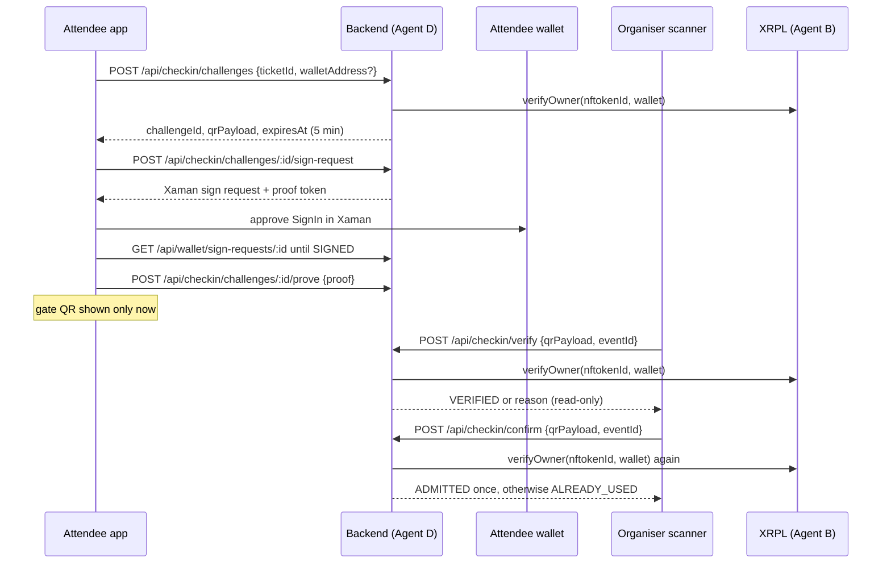

# Check-in and resale policy contract (Agent D)

Covers XRPL-044, 045, 046, 047 (check-in) and XRPL-037 (in-app resale policy).
Status: **check-in works end to end on Testnet.** The attendee approves in Xaman (Agent B's sign
requests, XRPL-011), ownership is read from XRPL (Agent B's read service, XRPL-007), and admission is
recorded once in Postgres. Who may scan follows Agent A's permission rule (XRPL-013): the event's owner.

| File | What it is |
|---|---|
| [`src/contracts/checkin.ts`](../src/contracts/checkin.ts) | Request schemas, result types, HTTP mapping, limitation notice |
| [`src/features/checkin/checkin-service.ts`](../src/features/checkin/checkin-service.ts) | Challenge, proof, verify and atomic admit |
| [`src/features/checkin/prisma-store.ts`](../src/features/checkin/prisma-store.ts) | `CheckInStore` / `TicketDirectory` on the XRPL-005 schema |
| [`src/features/checkin/ports.ts`](../src/features/checkin/ports.ts) | Interfaces other agents implement |
| [`src/features/checkin/xrpl-ownership.ts`](../src/features/checkin/xrpl-ownership.ts) | Adapter for Agent B's `verifyOwner` |
| [`src/features/checkin/xaman-proof.ts`](../src/features/checkin/xaman-proof.ts) | Wallet approval via Xaman SignIn, bound to one challenge |
| [`src/features/checkin/checkin-code-panel.tsx`](../src/features/checkin/checkin-code-panel.tsx) | Attendee "Show check-in code" panel (`/checkin/:ticketId`) |
| [`src/features/checkin/organiser-access.ts`](../src/features/checkin/organiser-access.ts) | Who may scan: delegates to Agent A's `isEventOwner` (XRPL-013) |
| [`src/features/checkin/server.ts`](../src/features/checkin/server.ts) | Route wiring and QR secret |
| [`src/app/api/checkin/`](../src/app/api/checkin/) | Route handlers |
| [`src/lib/resale-policy/resale-policy.ts`](../src/lib/resale-policy/resale-policy.ts) | `ResalePolicyPort` implementation |

Tests: `npm test` (unit, in-memory fakes) and `npm run test:db` (Prisma store against Postgres).

## Check-in flow

**QR payload:** `xtc1.<challengeId>.<hmacTag>`. The tag is HMAC-SHA256 with `CHECKIN_QR_SECRET`
over the challenge ID, event, ticket and expiry. The QR holds no wallet address, seed, name or contact
details. A tampered or forged QR, or one from another server, returns `INVALID_QR`.

**Why a screenshot does not work:** a challenge is only usable after the wallet holding the NFT
approves it in Xaman. The proof token is `<xamanRequestId>.<hmac(challengeId, xamanRequestId)>`, so
only a sign-in this server created **for this challenge** counts. An old `/connect` sign-in, or one
made for another code, is rejected. The server asks Xaman (authenticated with our API key) whether that
request was SIGNED on Testnet and by which account, then **verifies the signed blob itself** with Agent A's
`verifyXamanSignInBlob` (memo names this request, valid signature, master key of that account). That
account must be the challenge's wallet.
At the gate the ledger owner is read again, so a ticket transferred away after approval gets `WRONG_OWNER`.

**Wallet on the request:** the session's verified wallet is used when there is one (XRPL-012).
Otherwise the attendee names the wallet connected in their browser. That claim is safe to accept:
XRPL must show it holds the ticket, and it must approve in Xaman, before the code works.

**One entry only:** `admitAtomically` runs one transaction. It consumes the challenge only
`WHERE consumedAt IS NULL`, then inserts `CheckInRecord`, which is unique on `(ticketId, eventId)`.
A second scan with the same challenge, or with another challenge for the same ticket, gets
`ALREADY_USED`.

### Results

Failures use the standard envelope `{ error: { code: <status>, message }, requestId }`.

| Status | HTTP | Meaning |
|---|---:|---|
| `INVALID_QR` | 400 | Malformed or tampered code |
| `INVALID_PROOF` | 401 | Bad, replayed or wrong-wallet proof |
| `NOT_AUTHORISED` | 403 | Scanner is not an organiser for this event |
| `WRONG_EVENT` | 403 | Ticket is for another event |
| `WRONG_OWNER` | 403 | Wallet no longer holds the NFT |
| `UNKNOWN_TICKET` | 404 | Ticket not found, not minted, or NFT gone |
| `PROOF_REQUIRED` | 409 | Attendee has not approved in their wallet yet |
| `ALREADY_USED` | 409 | Ticket already checked in |
| `EXPIRED` | 410 | Challenge expired; attendee refreshes |
| `LEDGER_UNAVAILABLE` | 503 | XRPL unreachable; **never admit** |

## Resale policy (XRPL-037)

`ResalePolicy` implements `ResalePolicyPort` from `src/features/integration/ports.ts` and returns
`ResaleEligibility` from `src/contracts/events.ts`.

| `reasonCode` | When |
|---|---|
| `EVENT_NOT_PUBLISHED` | Event missing or still a draft |
| `EVENT_FINISHED` | `endsAt` (or `startsAt` when there is no end time) has passed |
| `PRIMARY_STILL_ON_SALE` | Any primary ticket left, or availability is inconsistent |
| `PRIMARY_SOLD_OUT` | `totalSupply > 0`, `remaining === 0` and `isSoldOut`: **resale allowed** |

- `listPublicOffers(eventId)` returns nothing unless eligible. It also keeps only `kind = RESALE`,
  `state = ACTIVE` offers for that event from `OfferPort.listResaleOffers`.
- `getPublicOffer(eventId, offerId)` is the guard for single-offer reads **and for Agent B's resale
  accept-intent route**, so a direct API call cannot reach a hidden listing.
- If inventory or offers cannot be read, the error propagates (503) and nothing is listed.
- Every eligibility `message` that mentions resale includes `RESALE_LIMITATION_NOTICE`. The UI must
  show it: the rule is app-only and does not stop transfers made directly on XRPL.

### Live routes

| Route | Returns |
|---|---|
| `GET /api/events/:id/resale-eligibility` | `ResaleEligibility` + `priceCapNotice` |
| `GET /api/events/:id/resale-offers` | `{ eligibility, offers: ResaleListing[], limitationNotice, priceCapNotice }`, cheapest first |

- Both are public for published events. Drafts are visible only to their owner (404 otherwise), the
  same rule as `/availability`. Both are never cached.
- Wiring (`src/lib/resale-policy/server.ts`):
  - sell-out comes from Agent A's `createInventoryPort()` (XRPL-020);
  - events come from the Event table;
  - offers come from the `NFTOffer` mirror: `RESALE`, `ACTIVE`, no `Destination`, with a validated create transaction.
- Agent B's accept route must still re-check the live offer on XRPL before a purchase, and can replace
  the offer source with its own `OfferPort`.
- Price cap: set `RESALE_MAX_MARKUP_PERCENT` (whole number 0–1000) to turn it on. Unset means off.

## What D still needs

| From | What | Used by |
|---|---|---|
| A (XRPL-012) | Session with a verified wallet (optional now; used in preference to the named wallet) | `issueChallenge` |
| A (XRPL-013) | Done: `organiser-access.ts` delegates to `isEventOwner` ([docs/auth/permissions.md](auth/permissions.md)) | Scanner routes |
| A (XRPL-020) | Real `InventoryPort.getAvailability` | Resale policy |
| B (XRPL-036) | Real `OfferPort.listResaleOffers` (live offers only) | Resale listings |
| C (XRPL-034) | Embed `<CheckInCodePanel ticketId />` on the ticket page (interim page: `/checkin/:ticketId`) | Attendee side |
| A (env) | Add `CHECKIN_QR_SECRET` (server-only, 32+ chars) to `src/lib/env.ts` and `.env.example`. Until then the key is derived from `SESSION_SECRET` | QR tags |

## Routes

All are `POST`, need a session cookie, and are same-origin only (CSRF check in `withApiHandler`).

| Route | Body | Who | Success |
|---|---|---|---|
| `/api/checkin/challenges` | `{ ticketId, walletAddress? }` | Attendee; wallet from session or body (else 403 `WALLET_NOT_VERIFIED`) | 201 challenge + `qrPayload` |
| `/api/checkin/challenges/:id/sign-request` | — | Attendee | 201 `{ signRequest, proof }` (Xaman SignIn) |
| `/api/checkin/challenges/:id/prove` | `{ proof }` | Attendee | 200 `PROVEN` |
| `/api/checkin/verify` | `{ qrPayload, eventId }` | Organiser | 200 `VERIFIED` (read-only) |
| `/api/checkin/confirm` | `{ qrPayload, eventId }` | Organiser | 201 `ADMITTED`; repeat gives 409 `ALREADY_USED`, so retries are safe |

## Wiring status (`src/features/checkin/server.ts`)

| Input | Now | Switch to |
|---|---|---|
| Tickets, challenges, check-ins | Prisma (live) | — |
| Who may scan | The event's owner (the SELLER/ORGANISER who created it), via Agent A's `isEventOwner` (XRPL-013) | — |
| XRPL ownership | Live: `XrplLedgerOwnership` over `getXrplQueryService().verifyOwner` (created on first use; any failure → 503 `LEDGER_UNAVAILABLE`) | — |
| Wallet proof | Live: Xaman SignIn via `getWalletSignRequests()` (needs `XAMAN_API_KEY`/`SECRET`; else 503) | — |
| QR key | `CHECKIN_QR_SECRET`, else derived from `SESSION_SECRET`, else (dev only) random per process | — |

## Organiser gate screen (XRPL-048)

`/organiser/events/:id/checkin`, for the event's owner only (XRPL-013).

- **Scanning:** the phone camera is offered where the browser can read QR codes itself (`BarcodeDetector`, e.g. Chrome on Android). The text box always works, including handheld scanners that type the code and press Enter. No extra library is added.
- **Flow:** scan → `POST /api/checkin/verify` → green "Valid ticket" with an **Admit** button → `POST /api/checkin/confirm` → "Admitted" → "Scan next ticket". Every failure is shown as red "do not admit" or amber "try again" (ledger unreachable, not yet approved in wallet, no connection). There is never an Admit button for a failed check.
- **Overview:** entry count against minted tickets, plus the last 10 admissions (`GET /api/organisers/events/:id/checkins`).
- **Linking:** nothing links to this page yet. Agent C's seller event management can link to it per event.

## Seller inventory (XRPL-021)

`/organiser/events/:id/inventory` (event's seller only), linked from `/organiser/events` ("My events")
and from the check-in screen's tabs.

| Column | Counted from |
|---|---|
| Total | `TicketTier.totalSupply` |
| Minted | `TicketNFT.mintStatus = MINTED` (validated mint) |
| Minting | `mintStatus` `PENDING`/`SUBMITTED` (shown as a badge) |
| On sale | minted, `primarySoldAt` null, with an `ACTIVE` `PRIMARY` offer |
| Sold | `primarySoldAt` set (validated primary sale, XRPL-032) |
| Unsold | total − sold |

Everything is read on the server from records written only after a validated XRPL transaction, so a
purchase appears once it is confirmed, never from optimistic client state. **Refresh** re-reads.
"Primary sold out" here is a display figure. The resale rule uses Agent A's `InventoryPort` (XRPL-020).
The handoff's `GET /api/events/:id/inventory` is Agent A's route; this page reads the same data directly.

## Organiser analytics (XRPL-076/077)

`/organiser/events/:id/analytics` (Analytics tab) and `GET /api/organisers/events/:id/metrics`, event's
seller only.

| Figure | Counted from |
|---|---|
| Tickets sold | `TicketNFT.primarySoldAt` set |
| Primary revenue | sum of `PRIMARY` offers in state `ACCEPTED` (validated accept), integer drops |
| Resales / volume | `RESALE` offers `ACCEPTED` (listed or cancelled ones are excluded) |
| Private transfers / gifts | `PRIVATE` / `GIFT` offers `ACCEPTED` |
| Checked in / not checked in | `CheckInRecord` count; sold − checked in |
| Check-ins over time | `CheckInRecord.scannedAt` in 5–1440-minute buckets (≤ 32 bars, empty buckets kept) |
| **Pending (separate, never added to the above)** | `LedgerTransaction` `NFTokenAcceptOffer` still `PENDING` for this event's tickets; offers in `PENDING_SIGNATURE`; tickets `PENDING`/`SUBMITTED` |

The chart has one series, so no legend. It has a hover and focus tooltip on every bar, and a
"Show as table" view. Bar colour is `#1d4ed8` in light mode and `#5f88ee` in dark mode, both passing
the dataviz palette checks against the card surface. Resales made outside the app are not counted.

## Reviews from verified attendees (XRPL-079)

**Status:** done end to end. Reviews are stored in Agent A's `Review` table (#146) via
`src/features/reviews/prisma-store.ts`. The table also enforces one review per check-in and a rating of 1–5.

- **Who may review:** a customer whose **verified, unrevoked** `WalletLink` address has a `CheckInRecord`
  for the event (`src/features/reviews/attendance.ts`). Checked on the server for every create and edit.
- **One review per customer per event:** a second post gets 409 `ALREADY_REVIEWED`; edit with PATCH.
- **Rating** 1–5 whole stars, **body** up to 2000 characters (optional). Moderated (`hiddenAt`) reviews are never listed.

| Route | Who | Result |
|---|---|---|
| `GET /api/events/:id/reviews` | Anyone (published events) | `{ reviews, count, averageRating, viewer }`, newest first |
| `POST /api/events/:id/reviews` | Signed-in attendee | 201; 403 `NOT_ATTENDED`; 409 `ALREADY_REVIEWED` |
| `PATCH /api/events/:id/reviews/mine` | Author | 200; 404 `REVIEW_NOT_FOUND` |

**UI:** `<EventReviews eventId />` (`src/features/reviews/event-reviews.tsx`) for Agent C's event page.
It shows the average, the list with an empty state, a star-rating form for attendees (edit mode if
they already posted), and plain messages for non-attendees and signed-out visitors.

`unavailableReviewStore` (503 for everything) is kept in `server.ts` to switch reviews off quickly if ever needed.

## Friend connections (XRPL-084)

**Status:** live. Friendships are stored in Agent A's `FriendConnection` and `UserBlock` tables through
`PrismaFriendStore` (`src/features/friends/prisma-store.ts`). The friend-list privacy setting lives in
`User.settings`.

- **Opt-in by design** (handoff §2.2). People connect by sharing a **friend code**, which is their
  account ID; there is no name search. A friend list is visible only to its owner unless they choose
  "my friends", and a private profile never shows it.
- **Stored once per pair**, lower account ID first, so "A asked B" and "B asked A" can't both exist.
  Asking someone who already asked you makes you friends, including when both people ask at once.
- **Remove and block** delete the connection. Block also stops requests in both directions, without
  saying why. `FriendService.areFriends` / `listFriendIds` exclude blocked people, so XRPL-085/086 must
  use them: removing or blocking someone revokes their access to anything shared later.

| Route | Result |
|---|---|
| `GET /api/friends` | `{ myCode, friends, incoming, outgoing, blocked, friendsVisibility }` |
| `POST /api/friends/requests` `{ userId }` | 201 PENDING, or 200 ACCEPTED if they'd asked you; 400 self, 404 unknown, 403 blocked, 409 pending/already friends |
| `POST /api/friends/requests/:id/respond` `{ accept }` | Accept or decline a request sent to you; 404 otherwise |
| `DELETE /api/friends/:userId` | Unfriend, or cancel/decline a pending request |
| `POST /api/friends/blocks` `{ userId }`, `DELETE /api/friends/blocks/:userId` | Block (idempotent), unblock (doesn't restore the friendship) |
| `PATCH /api/friends/settings` `{ friendsVisibility }` | `ONLY_ME` (default) or `FRIENDS` |
| `GET /api/users/:id/friends` | `{ visible, friends }`; a hidden list looks the same as an empty one |

The tables do part of the work: the unique index on the ordered pair is what stops two requests between
the same people, and deleting an account removes its connections and blocks.
`unavailableFriendStore` (503 for everything) is kept in `server.ts` to switch friendships off quickly if
ever needed.
