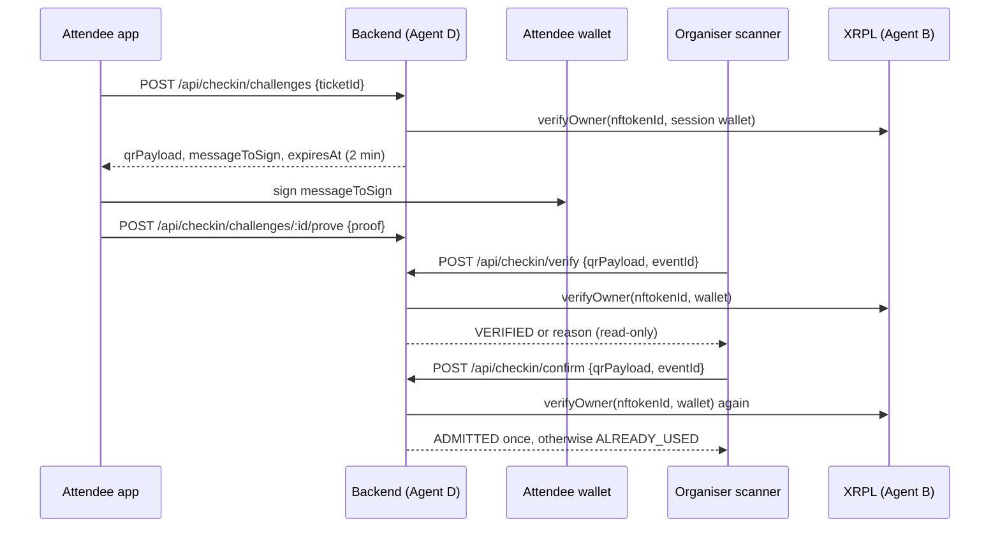

# Check-in and resale policy contract (Agent D)

Covers XRPL-044, 045, 046, 047 (check-in) and XRPL-037 (in-app resale policy).
Status: **core logic, Prisma store and the four `/api/checkin/*` routes are done.** Two inputs are
not connected yet, so those steps answer `503` instead of guessing: wallet-proof verification
(XRPL-012) and XRPL ownership reads (Agent B, PR #110). See "Wiring status".

| File | What it is |
|---|---|
| [`src/contracts/checkin.ts`](../src/contracts/checkin.ts) | Request schemas, result types, HTTP mapping, limitation notice |
| [`src/features/checkin/checkin-service.ts`](../src/features/checkin/checkin-service.ts) | Challenge, proof, verify and atomic admit |
| [`src/features/checkin/prisma-store.ts`](../src/features/checkin/prisma-store.ts) | `CheckInStore` / `TicketDirectory` on the XRPL-005 schema |
| [`src/features/checkin/ports.ts`](../src/features/checkin/ports.ts) | Interfaces other agents implement |
| [`src/features/checkin/xrpl-ownership.ts`](../src/features/checkin/xrpl-ownership.ts) | Adapter for Agent B's `verifyOwner` |
| [`src/features/checkin/organiser-access.ts`](../src/features/checkin/organiser-access.ts) | Interim "who may scan" rule |
| [`src/features/checkin/server.ts`](../src/features/checkin/server.ts) | Route wiring and QR secret |
| [`src/app/api/checkin/`](../src/app/api/checkin/) | Route handlers |
| [`src/lib/resale-policy/resale-policy.ts`](../src/lib/resale-policy/resale-policy.ts) | `ResalePolicyPort` implementation |

Tests: `npm test` (unit, in-memory fakes) and `npm run test:db` (Prisma store against Postgres).

## Check-in flow

**QR payload:** `xtc1.<challengeId>.<hmacTag>`. The tag is HMAC-SHA256 with `CHECKIN_QR_SECRET`
over the challenge ID, event, ticket and expiry. The QR holds no wallet address, seed, name or contact
details. A tampered or forged QR, or one from another server, returns `INVALID_QR`.

**Why a screenshot does not work:** a challenge is only usable after the wallet holding the NFT
signs `messageToSign`. That text contains a random nonce, the challenge ID, event, NFT ID and expiry.
A proof from another wallet, for another challenge, sent twice or sent after expiry is rejected. At
the gate the ledger owner is read again, so a ticket transferred away after the proof gets `WRONG_OWNER`.

**One entry only:** `admitAtomically` runs one transaction. It consumes the challenge only
`WHERE consumedAt IS NULL`, then inserts `CheckInRecord`, which is unique on `(ticketId, eventId)`.
A second scan with the same challenge, or with another challenge for the same ticket, gets
`ALREADY_USED`.

### Results

Failures use the standard envelope `{ error: { code: <status>, message }, requestId }`.

| Status | HTTP | Meaning |
|---|---:|---|
| `INVALID_QR` | 400 | Malformed or tampered code |
| `INVALID_PROOF` | 401 | Bad, replayed or wrong-wallet proof |
| `NOT_AUTHORISED` | 403 | Scanner is not an organiser for this event |
| `WRONG_EVENT` | 403 | Ticket is for another event |
| `WRONG_OWNER` | 403 | Wallet no longer holds the NFT |
| `UNKNOWN_TICKET` | 404 | Ticket not found, not minted, or NFT gone |
| `PROOF_REQUIRED` | 409 | Attendee has not approved in their wallet yet |
| `ALREADY_USED` | 409 | Ticket already checked in |
| `EXPIRED` | 410 | Challenge expired; attendee refreshes |
| `LEDGER_UNAVAILABLE` | 503 | XRPL unreachable; **never admit** |

## Resale policy (XRPL-037)

`ResalePolicy` implements `ResalePolicyPort` from `src/features/integration/ports.ts` and returns
`ResaleEligibility` from `src/contracts/events.ts`.

| `reasonCode` | When |
|---|---|
| `EVENT_NOT_PUBLISHED` | Event missing or still a draft |
| `EVENT_FINISHED` | `endsAt` (or `startsAt` when there is no end time) has passed |
| `PRIMARY_STILL_ON_SALE` | Any primary ticket left, or availability is inconsistent |
| `PRIMARY_SOLD_OUT` | `totalSupply > 0`, `remaining === 0` and `isSoldOut`: **resale allowed** |

- `listPublicOffers(eventId)` returns nothing unless eligible. It also keeps only `kind = RESALE`,
  `state = ACTIVE` offers for that event from `OfferPort.listResaleOffers`.
- `getPublicOffer(eventId, offerId)` is the guard for single-offer reads **and for Agent B's resale
  accept-intent route**, so a direct API call cannot reach a hidden listing.
- If inventory or offers cannot be read, the error propagates (503) and nothing is listed.
- Every eligibility `message` that mentions resale includes `RESALE_LIMITATION_NOTICE`. The UI must
  show it: the rule is app-only and does not stop transfers made directly on XRPL.

## What D still needs

| From | What | Used by |
|---|---|---|
| A (XRPL-012) | Session with a **verified** wallet address | `issueChallenge` (never from the request body) |
| A/B (XRPL-012) | `WalletProofVerifier.verify(message, proof)`, e.g. Xaman SignIn | `proveControl` |
| A (XRPL-013) | Role check to replace the interim rule in `organiser-access.ts` | Scanner routes |
| B (XRPL-007, PR #110) | `verifyOwner(nftokenId, address)` on a validated ledger, already adapted in `xrpl-ownership.ts` | Gate checks |
| A (XRPL-020) | Real `InventoryPort.getAvailability` | Resale policy |
| B (XRPL-036) | Real `OfferPort.listResaleOffers` (live offers only) | Resale listings |
| C (XRPL-034) | Ticket view renders `qrPayload` as a QR with an "Approve in wallet" step, refreshing at `expiresAt` | Attendee side |
| A (env) | Add `CHECKIN_QR_SECRET` (server-only, 32+ chars) to `src/lib/env.ts` and `.env.example`. Until then the key is derived from `SESSION_SECRET` | QR tags |

## Routes

All are `POST`, need a session cookie, and are same-origin only (CSRF check in `withApiHandler`).

| Route | Body | Who | Success |
|---|---|---|---|
| `/api/checkin/challenges` | `{ ticketId }` | Attendee with a **verified** wallet (else 403 `WALLET_NOT_VERIFIED`) | 201 challenge + `qrPayload` + `messageToSign` |
| `/api/checkin/challenges/:id/prove` | `{ proof }` | Attendee | 200 `PROVEN` |
| `/api/checkin/verify` | `{ qrPayload, eventId }` | Organiser | 200 `VERIFIED` (read-only) |
| `/api/checkin/confirm` | `{ qrPayload, eventId }` | Organiser | 201 `ADMITTED`; repeat gives 409 `ALREADY_USED`, so retries are safe |

## Wiring status (`src/features/checkin/server.ts`)

| Input | Now | Switch to |
|---|---|---|
| Tickets, challenges, check-ins | Prisma (live) | — |
| Who may scan | Interim: the event's own seller (SELLER/ORGANISER role) | Agent A's role check (XRPL-013) |
| XRPL ownership | `unavailableLedger` → 503 `LEDGER_UNAVAILABLE` | `new XrplLedgerOwnership(getXrplQueryService())` once PR #110 merges |
| Wallet proof | `unavailableProofs` → 503 | Agent A/B verifier (XRPL-012) |
| QR key | `CHECKIN_QR_SECRET`, else derived from `SESSION_SECRET`, else (dev only) random per process | — |

Next for Agent D: the organiser scanner UI (XRPL-048) and the edge-case suite (XRPL-049).
